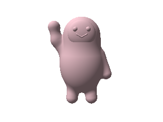
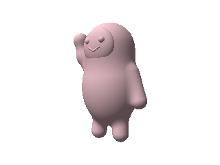

# Muse (Jolly), waving — worked example

A portrait of Muse's default avatar Jolly (pink-fur variant, left hand raised
in a wave), built as a hand-authored GLSL signed distance function following
this repo's skill workflow: draft `map()` from primitives → raymarch preview →
revise → marching-cubes mesh → STL.

 

## Files

- `muse.glsl` — the whole model: ~30 lines. Ellipsoid body, sphere head
  smooth-min blended, raised ellipsoid face plaque, sphere eyes, two-capsule
  smile, two-segment waving arm with a hand blob, one resting arm, two legs.
  y-up, ~2.5 units tall, front faces +z. Drops into any Shadertoy-style
  raymarcher.
- `muse-wave.stl` — marching-cubes mesh (150³ grid, 109k triangles, 5.2 MB),
  verified watertight bounds, no NaNs. Ready to slice.

## Build notes

- Two preview rounds. Round 1 fixed a camera bug (all rays converged on a
  target point inside the model) and resized the face; round 2 added the wave
  pose and pink tint from the reference photo.
- Face plaque sizing is the fiddly bit: on a sphere head of radius 0.52, a
  face wider than ~0.36 half-width pokes out the sides. Kept rx=0.36 with the
  center tucked just inside the head surface — shallow dome, which matches the
  reference (the real face is nearly flat relief; the eyes carry it).
- Fur is not modelable in SDF. This is a smooth designer-toy interpretation,
  not the fluffy original. Honest limits, per the skill README.

## Reproduce

```python
# numpy port of map() + raymarcher used for previews: see skill README.
# Mesh: sample map() on a 150^3 grid over x[-1.1,1.1] y[-1.4,1.4] z[-0.9,0.9],
# skimage.measure.marching_cubes at level 0, write binary STL.
```
