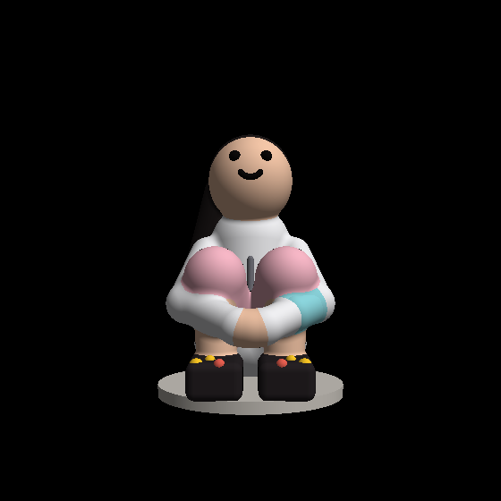
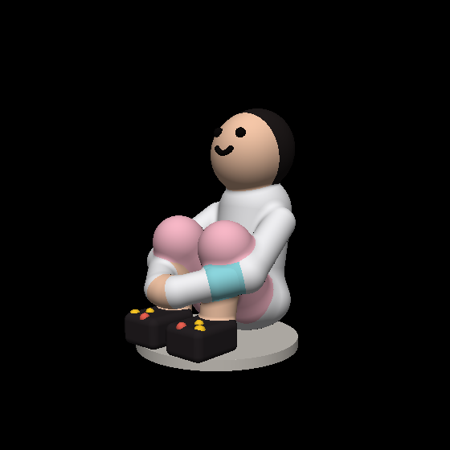

# Sitting-girl figurine (image-to-3D example)

A stylized 3D figurine built from a single reference photograph using this
repo's image-to-3D skill (v0.2.0). The reference photo (`reference.jpg`) shows
a young girl sitting on grass by the beach:
knees drawn up, arms wrapped around her shins with hands clasped, torso
leaning back slightly, head tilted up toward the sky. White zip-up jacket,
light pink shorts, chunky dark clogs with colorful charms, low ponytail,
light-blue wristband on one wrist.

The model is deliberately chibi-proportioned (large head), not photorealistic.

 

## Files

- `sitting_girl.py` — the SDF source: paired NumPy/GLSL definitions sharing
  one `SCENE` record table (name, kind, pivot/center, parameters, blend).
  Front +Z, Y-up, millimeters. 33 primitives: ellipsoids, capsules, spheres,
  rounded boxes, one exact capped `cylinder` (the base disc), and three
  head-frame primitives (`rx_ellipsoid`, `rx_sphere`, `rx_torus_arc`) that
  carry the −25° head tilt through the head, hair cap, eyes, and smile as one
  rigid group. Diagnostic material colors exist for previews only; the STL
  carries no color.
- `model.glsl` — the generated GLSL `map()` for the same field.
- `model.stl` — meshed output, 506,506 triangles, 80.0 × 116.7 × 94.5 mm.
- `previews/` — model-only shaded renders (front, three-quarter, side, top).

## Iteration rounds

Each round was rendered and compared against the reference photo:

- **v1** — first draft. Pose skeleton read correctly, but the −35° head tilt
  put the face on the crown from the front; forearms were buried inside the
  shins; knees oversized.
- **v2** — tilt reduced to −25° (face reads from the front, still gazing up);
  forearms re-routed to cross *in front of* the shins with hands clasped at
  center front; knees slimmed; shoes tucked under the shins; wristband
  re-seated.
- **v3** — ponytail thickened/lengthened for visibility.
- **v4** — detail + stability: smile tube thickened (r 0.9 → 1.4 mm) so it
  survives meshing; six stylized raised charms on the clogs; jacket collar
  and a thin raised zipper line on the torso front; a thin base disc
  (r 40 mm) that the shoes and seat merge into for print stability.

## Verification

- Repo test suite: **230 passed**; `ruff` clean.
- `sitting_girl.py` self-checks: analytic interior/exterior checkpoints pass;
  Lipschitz spot-check max ratio 0.9993 (field is globally 1-Lipschitz by
  construction: exact primitives, hard min, and polynomial smooth-min).
- Pipeline (`scripts/sdf_pipeline.py --trust-model`, resolution 256,
  declared min feature 1.9 mm): **watertight, winding consistent, positive
  volume, 1 connected component**.
- Not verified: physical printability and wall thickness (per the skill,
  validation ≠ print certification); GLSL/NumPy runtime equivalence was not
  executed (no GL compiler in the build environment — the GLSL mirrors the
  NumPy by construction with shared constants).

## Regenerate

```bash
python sitting_girl.py            # checkpoints + Lipschitz spot-check
python -m ruff check sitting_girl.py
python scripts/sdf_pipeline.py --trust-model --model sitting_girl.py \
    --output artifacts/final --resolution 256 --min-feature-mm 1.9
```
