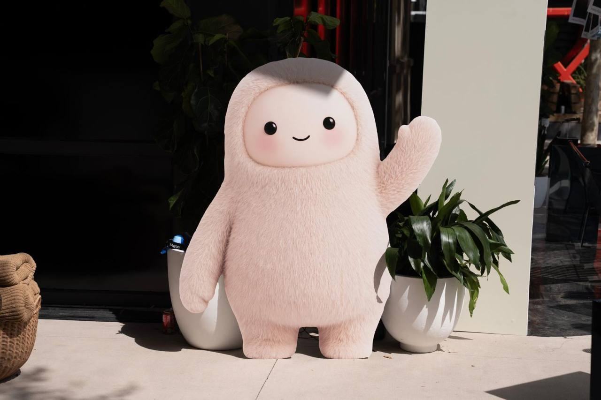

# Jolly: authoritative visual reference

This is the source image supplied by the user for the Jolly refinement. Preserve its original bytes. SHA-256: `7728cfa5602bf3d557f0076709a9311b374235234a6c108492ae506b37c8a583`.

## Required workflow for every Jolly change

1. Open this image before changing the model; use it rather than memory or a previous generated render as the visual authority.
2. Compare the current and proposed front render against this image. Also inspect side, three-quarter and top views for accidental distortions and disconnected geometry.
3. Record visible improvements, remaining mismatches and inferred geometry. Do not describe a single photo as exact 3D ground truth.
4. Run the full test suite, lint, pipeline build and STL reopen checks. Keep printability and GLSL runtime-equivalence limits explicit.

## Visible constraints

- Front faces +Z; Y is up. The raised waving hand is on the **viewer's right**, therefore positive X in the model's front view.
- The hood and torso form a continuous, broad plush silhouette; avoid a spherical bobble-head and narrowed neck.
- The pale face is a wide, rounded rectangle rather than a circular disk. Eyes are small and widely spaced; the smile is restrained.
- The raised arm angles outward/upward. Its mitten top is below the hood top; the opposite arm hangs beside the torso.
- Feet are short rounded blocks with comparatively flat soles and a visible central gap, not long capsule-shaped legs.
- Pink fur, cream fabric, black glossy eyes and the black smile are appearance cues. Smooth solid geometry does not reproduce fur or fabric. Diagnostic preview colors are not STL materials.

## What remains inferred

The photo does not uniquely determine rear geometry, thickness, exact scale, hidden connections or tolerances. The approximately 150 mm figurine scale is a modeling choice, not a measured dimension of the photographed object. Side/back proportions are a conservative stylized interpretation. Visual comparisons are qualitative, not calibrated pixel-fitting measurements.

## Reference rights

The image was supplied by the user for visual-reference inclusion. Photographer and rights-holder attribution have not been supplied. This reference photograph is **not licensed by this repository's MIT code license**; its original rights are retained. Do not represent it as an original repository asset or imply ownership of the depicted character.
